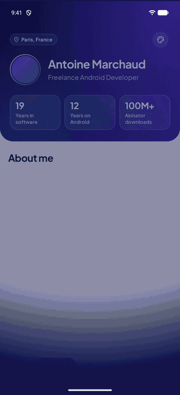
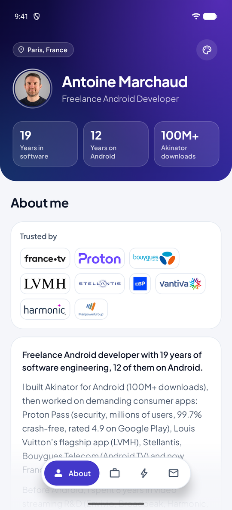
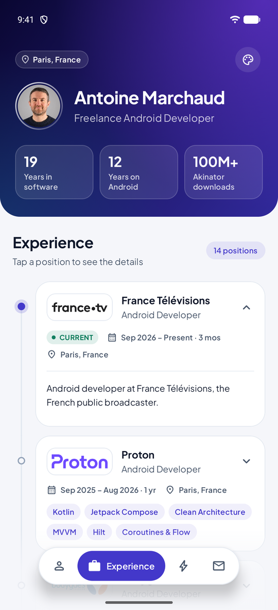
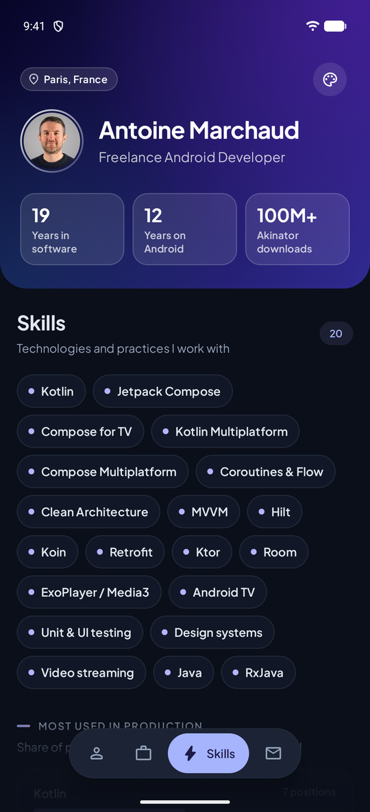
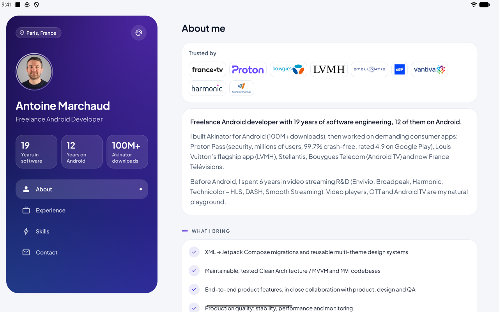
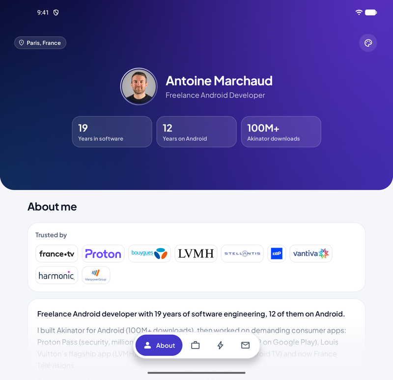

<h1 align="center">Resume Native</h1>

<p align="center">
  An adaptive, 100% Kotlin Android resume, driven by a single JSON file.<br/>
  Built with Jetpack Compose and Material 3, for phones, tablets and foldables.
</p>

<p align="center">
  
  
  
  
  
  
</p>

<p align="center">
  
  <br/>
  <a href="screenshots/demo.mp4">Watch the demo in HD (MP4)</a>
</p>

## Screenshots

<p align="center">
  
  
  
</p>
<p align="center">
  
  
  <br/>
  <sub>Tablet: two panes · Foldable in tabletop posture: profile above the hinge, content below</sub>
</p>

## Features

- **Adaptive layouts** following the Material 3 window size classes and foldable postures:

  | Window | Layout |
  |---|---|
  | Phone, portrait | Collapsing hero header and floating navigation bar |
  | Small tablet portrait, medium width | Collapsing hero header and floating navigation rail |
  | Tablet landscape, phone landscape, large screens | Two panes: profile and navigation on the left, content on the right |
  | Foldable in book posture | Two panes split exactly at the hinge |
  | Foldable in tabletop posture | Profile above the hinge, content and navigation below |

- **Four sections**: About (client logos, summary, strengths, education, languages), Experience (timeline), Skills (tags and usage chart), Contact.
- **Data-driven**: positions durations, the "Current" badge, technology usage and company monograms are computed from the JSON.
- **Polished design system**: custom indigo palette for light and dark themes, Plus Jakarta Sans typography, hairline cards, gradient hero.
- **Material You**: optional wallpaper-based colors on Android 12+, toggled from the header.
- **Motion**: collapsing header, staggered entrance animations, expandable cards, animated charts, section transitions.
- **Edge to edge**: fully transparent status and navigation bars, with icons that stay readable.
- **Selectable text**, to copy a client, a keyword or the email address into an email or an applicant tracking system.
- **Accessibility**: tabs, headings and toggle semantics, content descriptions, layouts that adapt to large font scales.
- **Compose previews** for every section and for every adaptive mode (phone, tablet, foldable postures, light and dark).

## Make it yours

Everything displayed comes from [`app/src/main/res/raw/resume_template.json`](app/src/main/res/raw/resume_template.json): edit it and run the app.

```jsonc
{
  "info": {
    "name": "Jane Doe",
    "job": "Senior Android Developer",
    "location": "Paris, France",                      // optional
    "stats": [{ "value": "10", "label": "Years on Android" }] // optional, computed when empty
  },
  "about": {                                           // optional
    "summary": ["First paragraph, displayed as a lead", "Next paragraphs"],
    "strengths": ["What you bring"]
  },
  "experiences": [
    {
      "company": "Acme",
      "role": "Android Developer",
      "start": "2024-03",                              // yyyy-MM
      "end": "2025-06",                                // omit for an ongoing position
      "location": "Paris, France",                     // optional
      "description": "One sentence about the position", // optional
      "highlights": ["What you did"],
      "technologies": ["Kotlin", "Jetpack Compose"],
      "appId": "com.acme.app",                         // optional, opens Google Play
      "logo": "logos/acme.png"                         // optional, company logo in assets/logos
    }
  ],
  "skills": ["Kotlin", "Jetpack Compose"],
  "education": [{ "school": "University", "degree": "Master's degree", "period": "2010 – 2015" }], // optional
  "languages": [{ "name": "English", "level": "Fluent" }], // optional
  "contact": {
    "email": "jane@example.com",
    "phone": "+33 6 00 00 00 00",                      // optional
    "githubUrl": "https://github.com/jane",            // optional
    "linkedInUrl": "https://www.linkedin.com/in/jane", // optional
    "message": "Short call to action"                  // optional
  }
}
```

Files written for the first version of the template (with a free-text `period` instead of `start` / `end`) are still supported.

## Tech stack

100% Kotlin, without any Java API in the code base.

| | |
|---|---|
| UI | Jetpack Compose, Material 3, `material3-adaptive` (window size classes and foldable postures) |
| Data | `kotlinx.serialization` (JSON), `kotlinx-datetime` (dates and durations) |
| Tests | `kotlin.test`, `kotlinx-io`, Compose UI tests (`runComposeUiTest`) |
| Build | Gradle 9.9.1 with version catalog and configuration cache, AGP 9.5.1 with built-in Kotlin, Java 21 toolchain |
| Release | R8 minification and resource shrinking |

## Project structure

```
app/src/main/java/com/amarchaud/templateresume
├── MainActivity.kt            Edge to edge, theme and Material You state
├── data
│   ├── ResumeModels.kt        JSON model
│   ├── ResumeParser.kt        Parsing of res/raw
│   └── ResumeInsights.kt      Pure functions: periods, durations, initials, technology usage
└── ui
    ├── components             Cards, chips, headers, entrance animations, centered lists
    ├── icons                  Material Symbols and brand icons as ImageVectors
    ├── preview                Fake data for previews
    ├── resume
    │   ├── ResumeLayout.kt    Window size class and posture → layout
    │   ├── ResumeScreen.kt    The four adaptive layouts
    │   ├── ProfileHero.kt     Collapsing header, profile pane, tabletop hero
    │   ├── Navigation.kt      Floating bar, floating rail, pane navigation
    │   ├── *Section.kt        About, Experience, Skills, Contact
    │   └── ResumeScreenPreviews.kt
    └── theme                  Colors, typography, shapes
```

## Build and checks

```bash
./gradlew assembleDebug                  # build the app
./gradlew testDebugUnitTest              # local unit tests
./gradlew connectedDebugAndroidTest      # Compose UI test on a device or an emulator
./gradlew lintDebug lintRelease          # Android lint
```

The project builds with **zero warnings**: Kotlin compiler, Gradle (`--warning-mode all`) and Android lint.

## Credits

- Font: [Plus Jakarta Sans](https://fonts.google.com/specimen/Plus+Jakarta+Sans), SIL Open Font License 1.1
- Icons: [Material Symbols](https://fonts.google.com/icons), Apache License 2.0
- Brand icons: [Simple Icons](https://simpleicons.org), CC0 1.0
- Company logos: [Wikimedia Commons](https://commons.wikimedia.org) and [Wikipedia](https://fr.wikipedia.org), public domain or CC0, except Vantiva (© Vantiva, [CC BY-SA 4.0](https://creativecommons.org/licenses/by-sa/4.0)) and EBP (registered trademark). All logos are trademarks of their respective owners.
